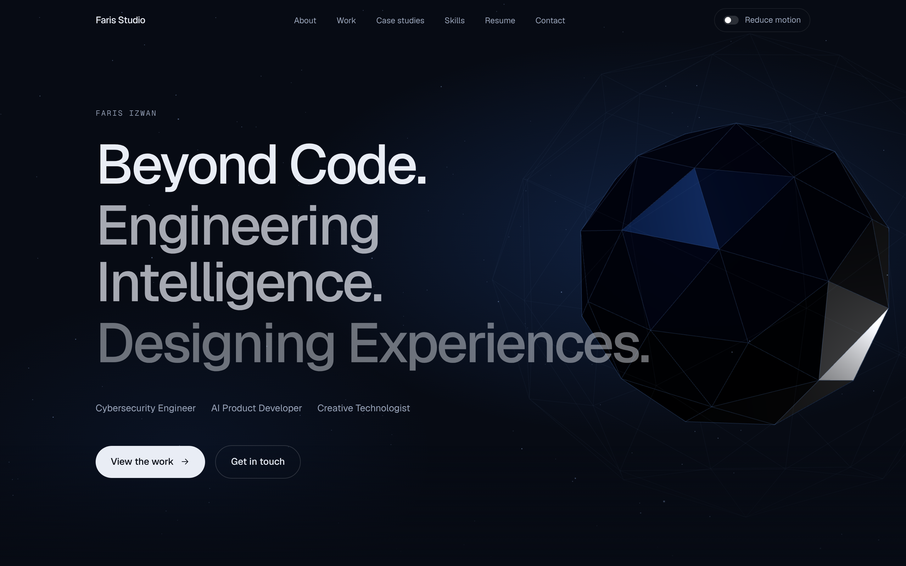
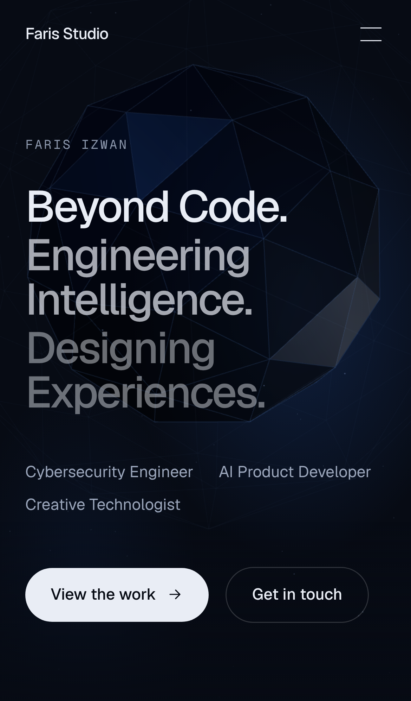
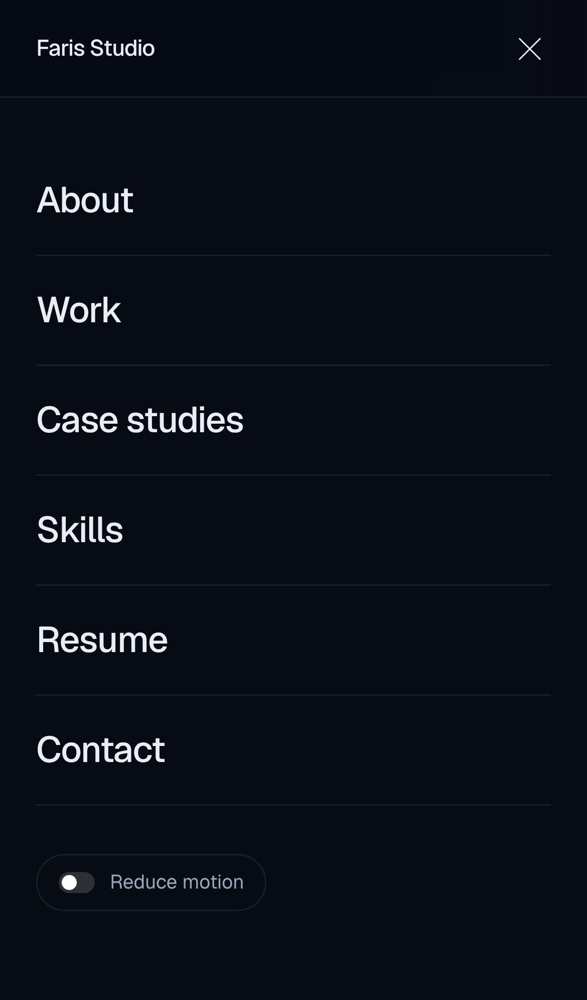

# Faris Studio

Personal portfolio for **Faris Izwan** — Cybersecurity Engineer · AI Product Developer · Creative Technologist.
*Beyond Code. Engineering Intelligence. Designing Experiences.*

Next.js (App Router) · TypeScript · Tailwind CSS v4 · Three.js · Framer Motion.



| Mobile hero | Mobile menu |
| --- | --- |
|  |  |

Full-page captures (home, case study, desktop and mobile) are in [`docs/screenshots`](docs/screenshots).
A shot-by-shot walkthrough for recording a demo is in [`docs/demo-storyboard.md`](docs/demo-storyboard.md).

## Quick start

```bash
npm install
npm run dev          # http://localhost:3000
```

Requires Node.js 20.9 or newer.

| Command | Purpose |
| --- | --- |
| `npm run dev` | Development server |
| `npm run build` / `npm start` | Production build / serve it |
| `npm run lint` · `npm run typecheck` | ESLint · TypeScript |
| `npm test` | Content-configuration tests (Vitest) |
| `npm run test:e2e` | Browser tests (Playwright) against a production build, desktop and mobile |
| `npm run screenshots` | Regenerate `docs/screenshots` from a running site |

First-time Playwright setup on a new machine: `npx playwright install chromium`.

## Before you launch — placeholders to replace

Search the project for `PLACEHOLDER`. The list today:

| Where | What |
| --- | --- |
| `NEXT_PUBLIC_SITE_URL` (env) | Your real domain. Drives canonical URLs, sitemap and Open Graph. |
| `src/content/site.ts` → `resumePdf` | Put a PDF in `public/` and set its path. Until then the site says the PDF is not published. |
| `src/content/profile.ts` → `resume.education` | Institution and years. |
| `src/content/profile.ts` → `resume.experience` | Dates for each role. |
| `src/content/projects.ts` → `placeholder-3d-iot` | Replace with a real 3D or IoT project, or set `showPlaceholders: false` in `site.ts`. |
| `src/content/profile.ts` → `skillGroups` | Review every "Practiced" level. They were copied from your GitHub profile README and are self-reported. |

## Where the content comes from

Nothing on the site was invented. Sources:

- **Identity, roles, tagline** — supplied in the project brief.
- **Experience, education, certifications, recognition, location, contact links** — the public GitHub profile README (`github.com/frsxizwan`).
- **Projects** — the three public repositories, read at source level. Descriptions state what the code does, and each case study lists its limitations. Where a repository README claimed more than the code contains, the site follows the code.

## Editing content

All copy lives in `src/content`. Components contain no project-specific text.

```
src/content/
  site.ts       name, roles, tagline, links, navigation, resume PDF path
  profile.ts    about text, principles, skills, resume
  projects.ts   categories and projects  ← add projects here
  types.ts      the shape each entry must follow
```

### Add a project

Append one object to `projects` in `src/content/projects.ts`:

```ts
{
  slug: "packet-lab",                 // becomes /projects/packet-lab
  title: "Packet Lab",
  summary: "One sentence, factual.",
  category: "cybersecurity",          // "cybersecurity" | "ai-software" | "creative"
  status: "prototype",                // "shipped" | "prototype" | "in-progress"
  year: "2027",
  stack: ["Python", "Scapy"],
  repo: "https://github.com/you/packet-lab",
  featured: true,                     // list it in the Case studies strip
  cover: { src: "/projects/packet-lab.webp", alt: "…", caption: "…", width: 1600, height: 900 },
  caseStudy: {
    problem: "…",
    approach: ["…", "…"],
    architecture: [
      { label: "Capture", nodes: [{ name: "sniffer.py", detail: "…" }] },
      { label: "Analyse", nodes: [{ name: "rules.py", detail: "…" }] },
    ],
    screenshots: [{ src: "/projects/packet-lab.webp", alt: "…", caption: "…", width: 1600, height: 900 }],
    storyboard: [{ title: "…", description: "…" }, /* three or more steps */],
    limitations: ["What it does not do."],
  },
}
```

That single entry produces the card, the category listing, the detail page, the sitemap entry and the test cases.
Omit `caseStudy` for a card with no detail page (work in progress). Put images in `public/projects/`.

`npm test` fails if a slug is duplicated, an image is missing, a case study lacks limitations, or a skill marked
"Demonstrated" has no evidence.

### Skill levels

Skills use three levels defined by evidence, not self-assessed percentages:

- **Demonstrated** — used in a public repository linked from the site (an `evidence` field is required).
- **Practiced** — coursework, labs or work; self-reported.
- **Learning** — currently studying.

## Architecture

```
src/
  app/
    layout.tsx               fonts, metadata, JSON-LD, skip link, providers
    page.tsx                 home: hero + six sections
    projects/[slug]/page.tsx statically generated case studies
    sitemap.ts robots.ts manifest.ts opengraph-image.tsx icon.svg not-found.tsx
  components/
    hero.tsx hero-canvas.tsx hero-scene.ts   headline + lazy-loaded Three.js scene
    header.tsx                                fixed nav, active-section tracking, mobile menu
    project-card.tsx architecture-diagram.tsx
    reveal.tsx section.tsx motion-provider.tsx motion-toggle.tsx
    sections/                                 about, work, case-studies, skills, resume, contact
  content/                                    all copy and configuration
  lib/motion-preference.ts                    reduced-motion store
e2e/     Playwright tests        tests/   Vitest content tests        scripts/  screenshots, perf probe
```

## Accessibility

- **Reduced motion** — a "Reduce motion" switch in the header, mobile menu and footer. It defaults to the operating-system
  setting, persists in `localStorage`, and is applied before first paint. When on: the 3D scene renders one static frame,
  scroll reveals appear instantly, smooth scrolling and CSS transitions are disabled.
- Semantic landmarks, one `h1` per page, ordered heading levels, skip link, visible focus rings.
- Mobile menu: `aria-expanded` / `aria-controls`, closes on Escape and returns focus to its button.
- The 3D canvas is decorative and `aria-hidden`; the page works without WebGL (a CSS gradient remains).
- Text contrast meets WCAG AA. Automated axe checks (WCAG 2.1 A/AA) run in the e2e suite on the home page and a case study.
- External links announce that they open in a new tab.

Automated checks do not replace a manual screen-reader pass; one has not been done.

## Performance

- Every route is statically prerendered.
- Three.js is loaded with a dynamic import after first paint, using named imports so it is tree-shaken. The headline never waits for it.
- The render loop pauses when the hero is off-screen or the tab is hidden; device pixel ratio is capped at 1.75.
- Images are WebP sources served through `next/image` (AVIF/WebP, responsive `sizes`, lazy below the fold).
- Fonts (Geist) are self-hosted via the `geist` package — no third-party font requests.

Local measurement against the production build on `localhost` (`node scripts/measure.mjs`): LCP 76 ms, CLS 0,
326 kB JavaScript transferred including the lazy Three.js chunk, 18 requests. These are loopback numbers, not field data —
run Lighthouse or PageSpeed Insights against the deployed URL for real figures.

## Tests

`npm run test:e2e` builds the site and runs 22 scenarios in two viewports (desktop Chrome, Pixel 7):

- every navigation link scrolls to its section; hero call-to-action
- mobile menu opens, closes on Escape, closes after selection
- project card → case study → back to work; next-project chaining; 404 for unknown slugs
- each case study renders its architecture, screenshots (images verified to load), storyboard and limitations
- reduced-motion toggle, persistence across reload, and OS-preference default
- contact links (mailto, GitHub, LinkedIn) and their attributes
- SEO: description, Open Graph, canonical, JSON-LD, sitemap, robots, OG image
- axe accessibility scan; no horizontal overflow

`npm test` runs 9 checks on the content configuration.

## Deployment

### Vercel (recommended)

1. Push this folder to its own GitHub repository.
2. In Vercel: **Add New → Project**, import the repository. Framework preset: Next.js. No build settings to change.
3. Add the environment variable `NEXT_PUBLIC_SITE_URL` = `https://your-domain` (no trailing slash).
4. Deploy, then attach your domain under **Settings → Domains**.

If the site stays inside a larger repository, set **Root Directory** to `faris-studio` in the Vercel project settings.

### Any Node host

```bash
NEXT_PUBLIC_SITE_URL=https://your-domain npm run build
npm start            # serves on PORT (default 3000)
```

### Static hosting (GitHub Pages, Netlify, S3)

Add `output: "export"` to `next.config.ts` and set `images: { unoptimized: true }`, then `npm run build` writes a
static site to `out/`. You lose on-the-fly image optimisation; everything else works.

### After deploying

- Open `/sitemap.xml` and `/robots.txt` and confirm they show your domain.
- Paste the URL into a link-preview checker to confirm the Open Graph image.
- Run Lighthouse on the live URL.
